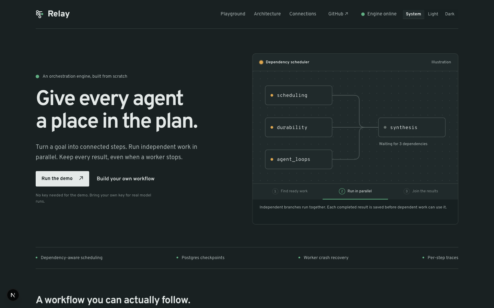
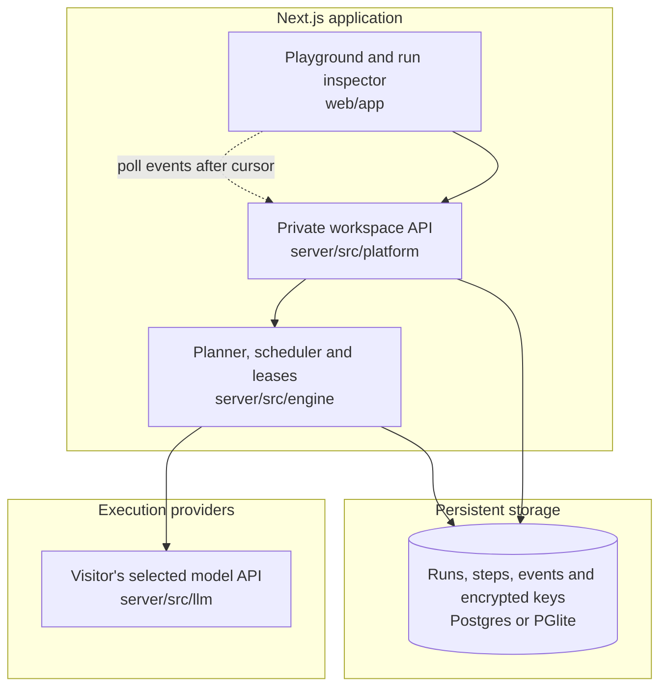
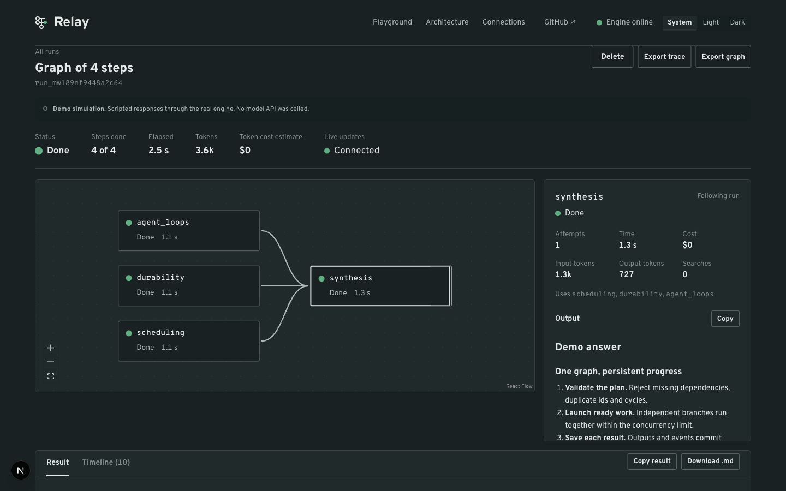
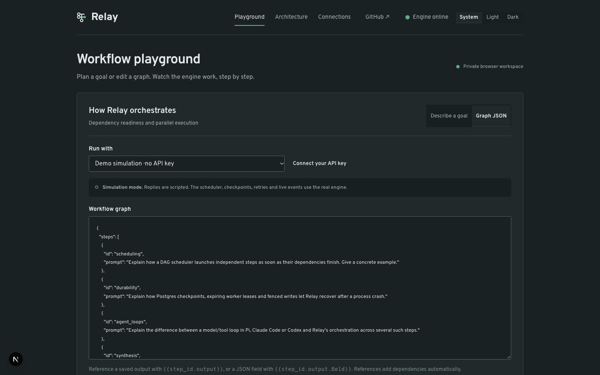
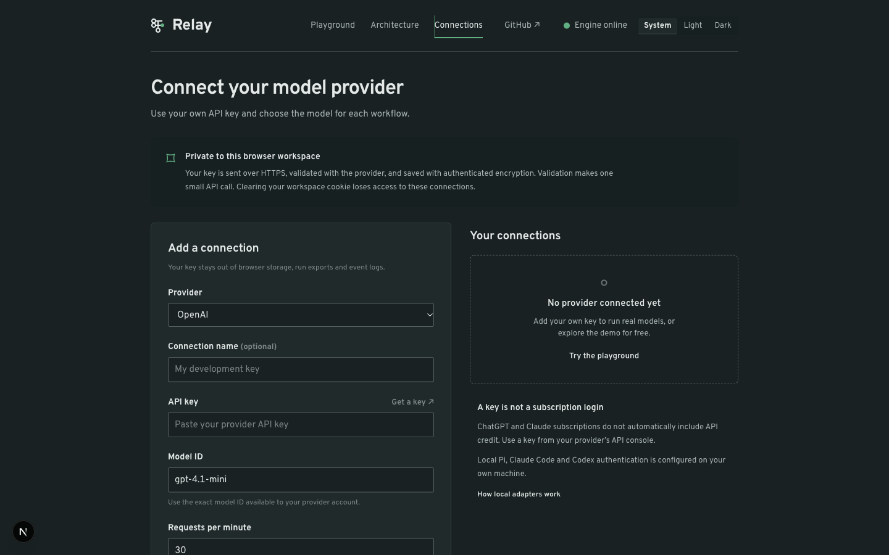

# Relay

**Individual portfolio project**

- [Pallab Das](https://github.com/PDGamerSG)

Live link: [relay-workflows-rust.vercel.app](https://relay-workflows-rust.vercel.app/)

<p align="center">
  
</p>

Relay turns a goal into a graph of model calls, runs independent steps in parallel, and saves progress so another worker can continue after a crash. Try the labelled simulation without a key, or connect your own model provider and inspect each prompt, result, attempt and event.

This repository contains the TypeScript orchestration engine, a Next.js playground, local adapters for Pi, Claude Code and Codex, and reproducible reliability demos. The scheduler, checkpoints, leases, retry policy and graph rewrites are implemented here rather than delegated to an orchestration framework.

## Features

| Feature | What it does |
| --- | --- |
| Goal planning and graph JSON | Generate a validated DAG from a goal or define dependencies yourself. |
| Parallel scheduling | Start each step as soon as its own inputs succeed, with concurrency and rate limits. |
| Durable recovery | Persist results and events in Postgres; expiring leases and fenced writes coordinate workers. |
| Failure handling | Retry transient failures, validate JSON outputs, re-plan failed goal branches, cancel or retry a run. |
| Bring your own key | Save an encrypted OpenAI, Anthropic, Gemini, Groq, Cerebras or OpenRouter connection in a private browser workspace. |
| Inspect and export | Explore the live graph, resolved prompts, timeline, token usage and estimated cost; export Markdown, graph JSON and trace JSON. |
| Local coding agents | Run Pi, Claude Code and Codex through shell-free process adapters with timeouts, cancellation and usage parsing. |
| Reproducible demonstrations | Six templates, a deterministic retry lab, a crash-recovery demo and simulated-latency benchmarks. |

## How it works

The browser submits a workflow; the engine validates it and checkpoints every completed step.



A goal goes through a planner; a submitted graph goes directly through validation. The scheduler resolves dependency templates, starts ready steps, and commits state with its event. Another worker can claim an expired lease and resume unfinished steps. Model API credentials come from the run's saved connection. Local agent adapters use the same provider interface in a separate, local process. See the [architecture](docs/ARCHITECTURE.md) and [source comparison](docs/research/agent-systems.md).

## Screenshots

Captured from the local application in Chromium at 1440 × 900. The run shown uses scripted demo responses, with real scheduling and database writes.

<p align="center">
  
</p>

*The run inspector exposes execution state, dependencies, usage and outputs.*

<table>
  <tr>
    <td><br/>Choose a template or define your own graph.</td>
    <td><br/>Connect a provider with your own API key.</td>
  </tr>
</table>

## Tech stack

| Component | Purpose | License |
| --- | --- | --- |
| TypeScript and Bun | Engine, scripts, tests and workspace tooling | Apache-2.0 / MIT |
| Next.js 16 and React 19 | Website and same-origin HTTP API | MIT |
| Postgres / PGlite | Transactions, checkpoints, leases and event history | PostgreSQL / Apache-2.0 |
| React Flow and Dagre | Interactive graph and automatic layout | MIT |
| Zod and Ajv | Input validation and JSON output contracts | MIT |
| Playwright | Browser workflow verification | Apache-2.0 |
| Vercel and Neon | Hosted application and pooled Postgres | Service terms |

See [third-party notices](THIRD_PARTY_NOTICES.md) for fonts, rendering packages and integration boundaries.

## Quick start

Use Bun 1.4.4 and Node.js 24 or newer. No API key or database server is required for the demo.

```bash
git clone https://github.com/PDGamerSG/Workflow-Orchestration-Engine.git
cd Workflow-Orchestration-Engine
bun install --frozen-lockfile
cp .env.example .env
bun run dev
```

Open [localhost:3000](http://localhost:3000). Click **Run the demo**, or use **Connections** to validate and save your own key. Public runs always use the selected connection or the simulation. Deployment-level API keys are not used for visitor runs. Local data lives in `web/data/pglite` unless `DATABASE_URL` is set.

### Checks

```bash
bun run test
bun run typecheck
bun run lint
bun run build
cd web
bunx playwright install chromium
bun run test:e2e
```

The [verification report](docs/testing/verification.md) records database tests, browser workflows, dependency audit and external-service limitations.

### Reliability and agent demos

```bash
bun run demo:crash
bun run bench
# Requires locally installed and authenticated agent CLIs:
bun run demo:agents --agent=codex
bun run demo:agents
```

The crash demo preserves completed steps and repeats only work interrupted before a checkpoint. The benchmark uses fixed simulated model latency: concurrency 4 completed the 12-step workload in 4.48 s versus 10.40 s at concurrency 1. These numbers measure scheduling, not model quality or live API throughput. See [benchmark results](docs/benchmark.md) and the [agent guide](docs/agents.md).

### Deploy

The site runs on Vercel with Neon Postgres. Import the repository with root directory `web`, set `DATABASE_URL` and a stable private `RELAY_SECRET` of at least 32 characters, and deploy. No model API key is required on the server. Follow the [deployment guide](docs/operations/deployment.md) for persistence, recovery, DNS and rollback.

## Repository map

| Path | What it holds |
| --- | --- |
| `server/src/engine/` | DAG validation, scheduling, transactions, leases, retries, budgets and cache |
| `server/src/planner/` | General and research planning, validation feedback and branch replacement |
| `server/src/platform/` | Browser workspaces, connection encryption, ownership checks and per-run runtimes |
| `server/src/llm/` | Model API adapters, scripted simulation and pricing |
| `server/src/agents/` | Local subprocess execution and Pi, Claude Code and Codex protocol mapping |
| `server/src/templates/` | Shared workflow catalog and execution tests |
| `server/scripts/`, `examples/` | Benchmarks, crash demonstration and multi-agent graph |
| `web/app/`, `web/components/` | Showcase, playground, connections, architecture and run inspector |
| `web/lib/`, `web/e2e/` | API client, event reducer, exports and browser tests |
| `docs/` | Architecture, setup, security, testing, research and presentation guides |

## Documentation

- [Documentation index](docs/README.md): setup, usage and engineering references.
- [Architecture](docs/ARCHITECTURE.md): request flow, data model, scheduling and recovery guarantees.
- [Configuration](docs/CONFIGURATION.md): deployment secrets, local storage and provider settings.
- [User guide](docs/user-guide.md): templates, BYOK, run inspection, retries and exports.
- [API](docs/api/README.md): cookie-scoped requests, schemas and errors.
- [Pi, Claude Code and Codex](docs/agents.md): how each adapter wraps an existing agent loop.
- [Security](docs/security/threat-model.md): credential handling, workspace boundaries and remaining risks.
- [Testing](docs/testing/test-plan.md): automated checks and how to reproduce the evidence.
- [Portfolio presentation](docs/portfolio.md): a five-minute demo and technical interview discussion.
- [Troubleshooting](docs/TROUBLESHOOTING.md): startup, provider, quota and recovery issues.

## Known limits

- The intended custom hostname `relay.pallabdas.me` has verified DNS, but its HTTPS/browser check remains pending. The live link above is verified.
- A browser cookie is the workspace credential. There is no account login, cross-device sync or recovery after the cookie is lost or expires.
- Serverless recovery needs a later API request. Unattended execution needs a persistent worker or scheduled wakeup.
- Interrupted steps execute at least once and can incur repeated provider charges. Side-effecting tools would require idempotency controls.
- The hosted site runs model calls. Pi, Claude Code and Codex execute locally; the public API cannot launch them or arbitrary commands.
- Dollar totals are estimates from supplied token prices. Budgets stop new steps after recorded usage reaches the limit; in-flight calls can exceed it. Rate limits are per process and connection.
- Authenticated live provider and coding-agent executions were not verified in this release environment because working credentials were unavailable. Process/protocol fixtures and the public simulation are verified.
- This is a portfolio deployment with per-workspace run limits, not a multi-tenant service with billing, abuse prevention, SSO or a job-completion SLA.

## License

No project license has been declared. Contact Pallab Das before reusing project code. Third-party components retain their own licenses; see [THIRD_PARTY_NOTICES.md](THIRD_PARTY_NOTICES.md).
