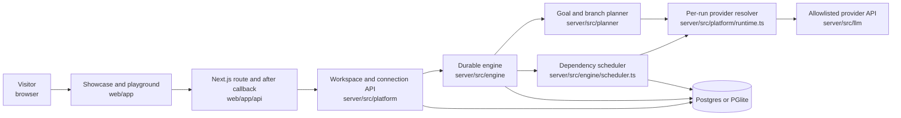
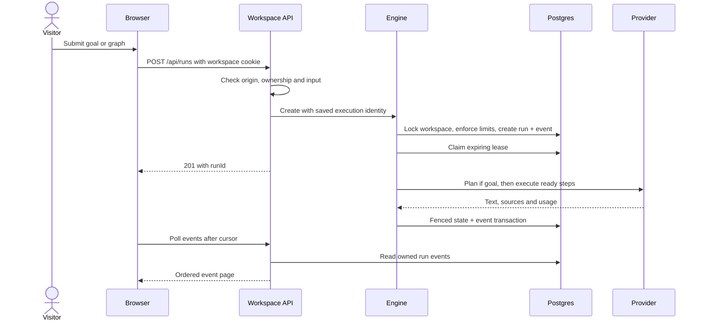
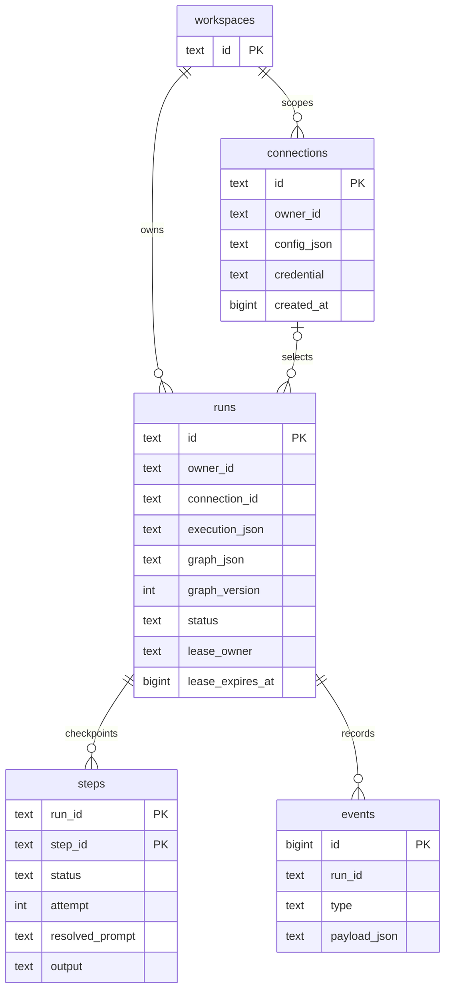
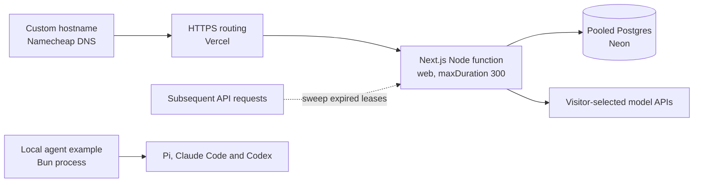

# Architecture

Relay separates workflow coordination from inference. The engine owns the DAG, persisted state, dependency readiness, ownership and failure policy. A provider owns one model call or local agent invocation.

## Components and context

Sources: [`route.ts`](../web/app/api/%5B...path%5D/route.ts), [`relay.ts`](../server/src/relay.ts), [`platform`](../server/src/platform/), [`engine.ts`](../server/src/engine/engine.ts).

`server/` is a library workspace. `web/` embeds it in one Next.js Node runtime; there is no separate HTTP backend or managed queue. The browser initializes its workspace before concurrent API calls so initial requests cannot create competing cookies.

## Request and checkpoint flow

Sources: [`handler.ts`](../server/src/api/handler.ts), [`engine.ts`](../server/src/engine/engine.ts), [`store.ts`](../server/src/engine/store.ts), [`api.ts`](../web/lib/api.ts), [`use-run.ts`](../web/lib/use-run.ts).

Creation locks a workspace row to enforce at most three active and 100 saved runs across concurrent requests. Graph state and the creation event commit atomically. A separate claim starts work after that transaction. A connection row lock coordinates run creation with credential deletion.

## Scheduling and failure policy

A normalized graph contains 1–50 steps and a stable topological order. Template references add dependencies automatically. Kahn's algorithm validates the order; cycle errors include a path. The scheduler fills available concurrency slots whenever a dependency finishes. A slow branch does not block unrelated chains.

At launch it resolves `{{step.output}}`, JSON paths, sources and `{{goal}}` from checkpoints. JSON outputs are parsed and validated with Ajv. Retryable failures include timeouts, HTTP 429/5xx and invalid structured outputs. Authentication, input and template failures stop immediately. Backoff uses exponential delay with jitter or the provider's `Retry-After` value.

For goal runs, a failed branch can trigger replacement planning. Code renames collisions, rewrites downstream references and validates the graph before installing a new version. Superseded rows remain inspectable. Manual retry retains succeeded checkpoints.

Sources: [`graph.ts`](../server/src/engine/graph.ts), [`template.ts`](../server/src/engine/template.ts), [`scheduler.ts`](../server/src/engine/scheduler.ts), [`retry.ts`](../server/src/engine/retry.ts), [`planner.ts`](../server/src/planner/planner.ts).

## Persistent data

Sources: [`store.ts`](../server/src/engine/store.ts), [`connections.ts`](../server/src/platform/connections.ts). Relationships show logical ownership; not every relationship has a database foreign key. The additional `step_cache` table stores opt-in reusable outputs. Visitor cache keys include the workspace/connection namespace.

Rows also track timestamps, usage, costs, sources, errors and budgets. Run totals combine step totals with recorded planning usage. Unknown usage from interrupted or rejected requests cannot be reconstructed from the provider bill.

## Leases and recovery

Only the worker holding an active run's lease may write results. Each state/event transaction locks the run row and checks ownership and active status. A worker that loses its lease aborts and cannot overwrite a successor's checkpoints. Cancellation changes the shared status, which closes the write fence.

An expired lease permits takeover. The successor resets interrupted steps to pending and retains succeeded steps. This is **at-least-once execution**: a provider may have processed an interrupted request, so repeating it can cost money. There is no exactly-once inference guarantee.

`bun run demo:crash` demonstrates takeover with two engines sharing a database. `Engine.start()` supports periodic sweeping for a persistent process; the hosted route sweeps on incoming requests. No visitor means no guaranteed serverless wakeup.

Sources: [`engine.ts`](../server/src/engine/engine.ts), [`store.ts`](../server/src/engine/store.ts), [`crash-demo.ts`](../server/scripts/crash-demo.ts).

## Model APIs and local agents

Hosted runs resolve an `LlmProvider` from their persisted connection id. The registry decrypts the key only on the server and supplies the provider and planner with the same limiter. One run uses one saved API connection. Dollar budgets require configured prices and stop new launches rather than in-flight calls.

Pi, Claude Code and Codex implement their own model/tool loops. Relay's local `AgentProvider` launches one such loop as a workflow step and translates final output and usage. The multi-agent example routes three parallel analyses to those executables, then joins them with a synthesis step. These processes are unreachable through the hosted API.

Sources: [`runtime.ts`](../server/src/platform/runtime.ts), [`providers.ts`](../server/src/platform/providers.ts), [`agents`](../server/src/agents/), [`agents-demo.ts`](../server/scripts/agents-demo.ts). See [agent details](agents.md) and [primary research](research/agent-systems.md).

## Deployment

Sources: [`route.ts`](../web/app/api/%5B...path%5D/route.ts), [`db.ts`](../server/src/engine/db.ts), [`agents-demo.ts`](../server/scripts/agents-demo.ts). The route declares a 300-second duration; hosting plan limits remain provider-controlled.

The encryption secret is configuration, not database content. Preserve it across redeployments. PGlite and its generated development secret require local persistent disk; a serverless deployment requires Postgres and an explicitly configured secret.
